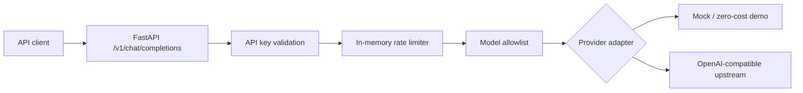

# LLM Gateway Platform

An extensible, API-first LLM gateway MVP using **Python, FastAPI, Docker and pytest**.
Built as an engineering portfolio project focused on controlled model access, reliable API contracts and operational fundamentals.

> **Status:** Phase 1 — working local MVP. This is **not** a production-hardened gateway or a deployed hosted service.

## Architecture



## Features

- `X-API-Key` authentication using constant-time key comparison.
- Per-minute request limit **per process** (fixed window).
- Model allowlist and validated request payload.
- Mock mode that costs nothing and never calls external AI services.
- Optional HTTPS-based OpenAI-compatible upstream adapter.
- Request IDs and metadata-only logs; no prompt or credential logging.
- Container execution as a non-root user.
- Automated tests via GitHub Actions.

## Getting started — Windows PowerShell

```powershell
Copy-Item .env.example .env
py -3.11 -m venv .venv
.\.venv\Scripts\Activate.ps1
python -m pip install -r requirements-dev.txt
python -m pytest -q
uvicorn app.main:app --reload
```

Python 3.11 or newer is required. If `py -3.11` is unavailable, use `python -m venv .venv` with Python 3.11+.

Open `http://127.0.0.1:8000/docs` for the OpenAPI documentation.

### PowerShell request example

```powershell
$headers = @{ "X-API-Key" = "replace-this-with-a-long-random-secret-please" }
$body = @{
  model = "demo-model"
  messages = @(@{ role = "user"; content = "Explain rate limiting in one sentence" })
} | ConvertTo-Json -Depth 5
Invoke-RestMethod -Uri "http://127.0.0.1:8000/v1/chat/completions" -Method Post -Headers $headers -ContentType "application/json" -Body $body
```

The response begins with `[MOCK - no real model inference]` to avoid misrepresenting a stubbed response as a real LLM inference.

## Docker

```powershell
Copy-Item .env.example .env
# Replace GATEWAY_API_KEY in .env with your own long random secret.
docker compose up --build -d
docker compose logs -f
docker compose down
```

Docker Compose binds only `127.0.0.1:8000`, **not** the public internet.

## Connecting an OpenAI-compatible provider

Edit `.env` and supply:

```dotenv
PROVIDER=openai_compatible
PROVIDER_API_KEY=your-actual-provider-credential
PROVIDER_BASE_URL=https://api.openai.com/v1
ALLOWED_MODELS=the-actual-model-id-enabled-in-your-account
```

Use the upstream provider's actual model ID. API usage can incur provider charges. The adapter assumes the upstream implements the OpenAI-compatible `POST /chat/completions` contract; not every service uses the same path or parameters.

## Security and production limitations

- Do not publish `.env`, secrets, customer prompts or proprietary code.
- The single API key is suitable for local demonstration only; production should use multi-tenant identities, credential rotation, secret management, audit trails and appropriate access policies.
- Rate limiting uses **in-memory state**, so counters are not shared between replicas and are reset when a process restarts. A production implementation should use Redis or a dedicated API gateway.
- Streaming, retries with backoff, token-level budgeting, distributed tracing, circuit breakers, governance and persistence are planned, **not implemented**.
- The mock adapter does not perform AI inference and does not return real token usage.
- Use HTTPS/TLS termination and additional abuse protection before exposing a production deployment.
- This project does not need a database or paid cloud infrastructure to run locally.

## Roadmap

1. ✅ Local MVP, authentication, allowlist, request limiting, Docker and tests.
2. ⬜ Multi-provider routing, real token/cost measurement, resilience patterns.
3. ⬜ Metrics, structured telemetry, evaluation and security hardening.
4. ⬜ CI/CD deployment and public architecture case study.

## License

MIT. See [LICENSE](LICENSE).
