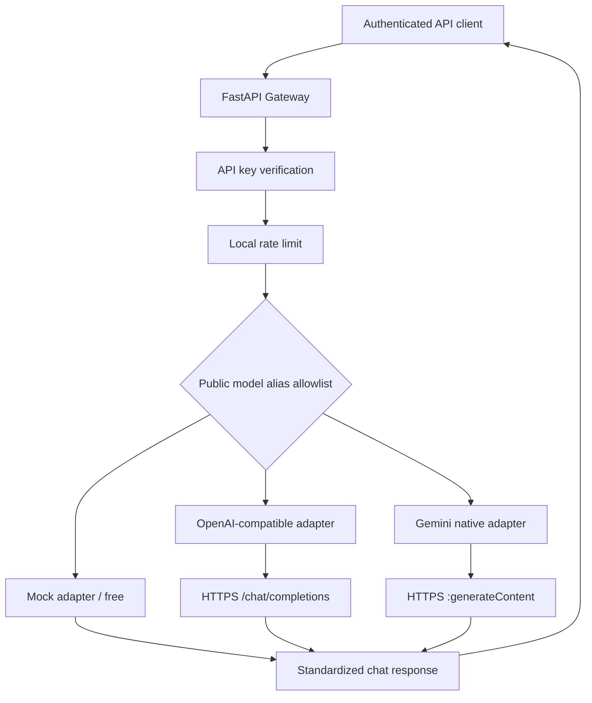

# LLM Gateway Platform

**Portfolio case study** · Python 3.11+ · FastAPI · HTTPX · Docker · pytest · GitHub Actions

A lightweight, multi-provider LLM gateway that exposes a consistent chat-completion interface. It supports local zero-cost testing, OpenAI-compatible APIs, and the native Google Gemini `generateContent` API. It is a deliberately small engineering project: clear boundaries, no database, no SDK lock-in, no cloud bill required for development.

> **Status: Phase 3 — multi-provider local prototype.** It is NOT a publicly deployed or production-hardened SaaS. Do not use with sensitive customer data or expose directly to the internet.

## Architecture



**Example routing:** `demo-model` → mock; `openai-main` → OpenAI-compatible upstream; `gemini-main` → Google Gemini native API. A caller can only specify a **public alias** configured by the operator: URLs, upstream model identifiers and secrets are never accepted from the caller.

## Features implemented

- `GET /health` (public); `GET /v1/models` and `POST /v1/chat/completions` (protected with `X-API-Key`).
- Multiple configured providers in one gateway process using a `MODEL_ROUTES` JSON map.
- OpenAI-compatible provider (including `https://api.openai.com/v1`) and Gemini REST `generateContent` provider.
- Provider-neutral output with `model`, `choices` and `usage` **only if reported by upstream** (no fictitious token counts or money estimates).
- Per-process, fixed-window rate limiting, timeout, safe upstream error mapping, and **opt-in** exponential retries.
- Request ID and metadata-only access logs. Prompts, responses, upstream error bodies and credentials are not logged by application code.
- Docker image with non-root user; Docker Compose binds only `127.0.0.1`.
- CI unit/integration-contract tests with **mocked HTTP transport** (no paid requests in CI).
- Streaming, tool calling, distributed quota, real billing limits, tracing, budgets and failover are **not** yet implemented.

## Start locally — PowerShell

Inside the project root:

```powershell
py -3.11 -m venv .venv
.\.venv\Scripts\Activate.ps1
python -m pip install -r requirements-dev.txt
if (!(Test-Path .env)) { Copy-Item .env.example .env }
python -m pytest -v
uvicorn app.main:app --reload
```

Open http://127.0.0.1:8000/docs to inspect the API.

### Request in zero-cost mock mode

Create a long random `GATEWAY_API_KEY` value in `.env` and use the same value for API requests. The value below is **only the example from `.env.example`**; use your own in practice.

```powershell
$headers = @{ "X-API-Key" = "replace-this-with-a-long-random-secret-please" }
$body = @{
  model = "demo-model"
  messages = @(@{ role = "user"; content = "Explain MLOps in one sentence" })
  max_tokens = 128
} | ConvertTo-Json -Depth 6
Invoke-RestMethod -Uri "http://127.0.0.1:8000/v1/chat/completions" -Method Post -Headers $headers -ContentType "application/json" -Body $body
```

Check the enabled aliases with `Invoke-RestMethod -Uri "http://127.0.0.1:8000/v1/models" -Headers $headers`.

## Configure real providers (OPTIONAL; may cost money)

To use two real providers **at the same time**, edit your untracked `.env` file (not `.env.example`) and set the following lines. Replace model IDs with **actual models available to your provider account**. Example model IDs are illustrative; access, pricing and free-tier eligibility change.

```dotenv
MODEL_ROUTES={"demo-model":{"provider":"mock","upstream_model":"demo-model"},"openai-main":{"provider":"openai_compatible","upstream_model":"gpt-4.1-mini"},"gemini-main":{"provider":"gemini","upstream_model":"gemini-2.5-flash"}}
OPENAI_API_KEY=your-own-openai-compatible-provider-key
GEMINI_API_KEY=your-own-google-ai-studio-gemini-key
PROVIDER_BASE_URL=https://api.openai.com/v1
PROVIDER_TIMEOUT_SECONDS=20
MAX_UPSTREAM_RETRIES=0
```

You do **not** need to enable both. For Gemini-only, leave `OPENAI_API_KEY=` blank and omit the `openai-main` alias; for OpenAI-only, do the analogous thing for `GEMINI_API_KEY`. Restart Uvicorn after updating `.env` (changes to environment files are not automatically reloaded by settings cache). Never publish `.env` or paste real keys into GitHub or chat.

**Get credentials:**

- OpenAI: create/manage API credentials in https://platform.openai.com/api-keys . OpenAI API billing is separate from ChatGPT subscriptions.
- Google Gemini Developer API: https://aistudio.google.com/apikey . Google publishes free and paid API tiers, with per-model and account-dependent quotas; confirm eligibility and usage conditions before calling a real model. The free tier may permit use of data to improve Google products—do not send confidential prompts without checking the applicable terms.

### Call the real model through the same endpoint

```powershell
$headers = @{ "X-API-Key" = "YOUR_LOCAL_GATEWAY_KEY" }
$body = @{
  model = "gemini-main"  # Or openai-main
  messages = @(@{ role = "user"; content = "Define drift detection in one sentence" })
  max_tokens = 64
} | ConvertTo-Json -Depth 6
Invoke-RestMethod -Uri "http://127.0.0.1:8000/v1/chat/completions" -Method Post -Headers $headers -ContentType "application/json" -Body $body
```

**Avoid unexpected charges:** mock remains free; real providers may charge by tokens. Keep `max_tokens` low, use the provider's own budget/quotas, verify billing, and keep `MAX_UPSTREAM_RETRIES=0` unless you explicitly accept possible duplicate requests (including double billing after ambiguous timeouts). The gateway cannot enforce a currency-denominated spending cap.

### Compatibility with Phase 1

If `MODEL_ROUTES` is unset or `{}`, the Phase 1 settings `PROVIDER` and `ALLOWED_MODELS` remain valid. `PROVIDER_API_KEY` remains a fallback for the OpenAI-compatible provider. You can keep your existing `.env` untouched to run mock mode after updating the source files.

## Error handling and security boundaries

| Condition | Client HTTP response |
| --- | --- |
| Missing or wrong gateway key | `401` |
| Too many gateway requests (fixed window) | `429` and `Retry-After` |
| Alias is not configured | `400` |
| No provider credential configured | `503` |
| Upstream quota/rate limit | `429` |
| Upstream authentication or other upstream HTTP failure | `502` |
| Upstream timeout | `504` |
| Invalid upstream response | `502` |

Notes: Auth is one shared key, not user/tenant RBAC. The gateway's rate limiter is process-local (not distributed), so it cannot enforce global spending or quotas. It supports **text-only** requests with `stream=false`; tool calls, multimedia, SSE, and automatic failover are unsupported. Requests are not automatically redacted before being sent to the selected provider. To protect budgets, deploy only after adding network-level controls, tenant authentication, distributed quotas, observability, and provider billing alerts. Do not expose Uvicorn directly on the public internet.

## Tests and CI

```powershell
python -m pytest -v
```

External traffic is simulated via `httpx.MockTransport`. Contract tests check route selection, OpenAI and Gemini request/response mapping, missing credentials, allowlisting, retry limits and sanitized errors. `.github/workflows/tests.yml` runs tests on pushes and pull requests to `main` without provider secrets.

## Docker

```powershell
# Create .env if needed, then set your own gateway API key.
docker compose up --build -d
docker compose logs --tail 50
docker compose down
```

## Project roadmap

1. ✅ Phase 1 — authentication, allowlist, mock inference, Docker and CI.
2. ✅ Phase 3 — concurrent provider routing, native Gemini, OpenAI-compatible integration, timeout, sanitized errors and opt-in retries.
3. ⬜ Operational hardening — distributed rate limits, budget enforcement, metrics, tracing, circuit breakers, secrets manager, stronger auth.
4. ⬜ Optional HTTPS deployment, reproducible performance results and a portfolio architecture case study.

## References

- https://platform.openai.com/docs/api-reference/chat/create
- https://ai.google.dev/api/generate-content
- https://ai.google.dev/gemini-api/docs/pricing

## License

MIT. See [LICENSE](LICENSE).
